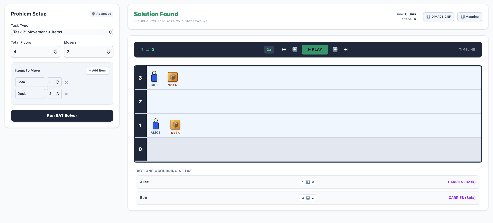
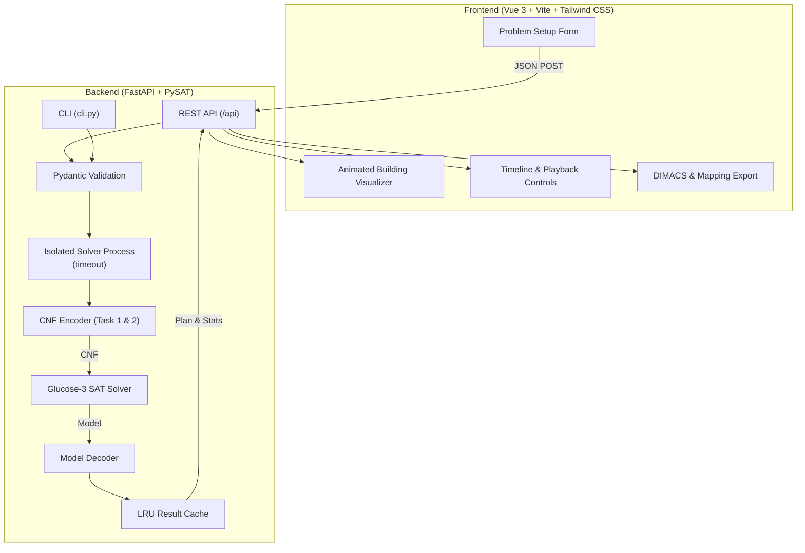

# OptiMove | Movers SAT Solver

[](https://github.com/simo-macca/toc-movers-sat/actions/workflows/ci.yml)
[](LICENSE)
[](https://www.python.org/)
[](https://fastapi.tiangolo.com/)
[](https://pysathq.github.io/)
[](https://vuejs.org/)
[](https://vite.dev/)
[](https://tailwindcss.com/)
[](https://www.docker.com/)

A full-stack web application, command-line interface and SAT-encoding engine that **optimally** solves the
**"Movers" logistics planning problem**. The planning problem is translated into propositional
**Conjunctive Normal Form (CNF)** and solved with the **Glucose-3** SAT solver (via
[`python-sat`](https://pysathq.github.io/)) to compute the shortest possible schedule for moving people and items
between the floors of a building.



> Developed by **Group C** for the *Theory of Computation* course. See [Authors](#authors).

---

## Table of Contents

- [The Problem](#the-problem)
- [System Architecture](#system-architecture)
- [Repository Structure](#repository-structure)
- [Quick Start (Docker Compose)](#quick-start-docker-compose)
- [Native Local Setup](#native-local-setup)
- [Command-Line Interface (CLI)](#command-line-interface-cli)
- [Engine Features](#engine-features)
- [SAT Encoding at a Glance](#sat-encoding-at-a-glance)
- [Benchmark Scenarios](#benchmark-scenarios)
- [Running the Tests](#running-the-tests)
- [Technical Report](#technical-report)
- [Authors](#authors)

---

## The Problem

Given a building with $N$ floors (indexed $0$ to $N-1$), $M$ movers and a set of items, find a discrete-time
schedule over time steps $t = 0, 1, \dots, T$ that **minimizes $T$** while respecting all movement rules.

### Task 1: Movement Only

- All movers start on the ground floor (floor $0$) at $t = 0$.
- Each mover must be on their goal floor at time $T$.
- At each step $t \to t+1$ a mover can **ascend** one floor, **descend** one floor, or stay **idle**.
- Movers cannot go above floor $N-1$ or below floor $0$.

### Task 2: Movement + Carrying

- Extends Task 1 with items placed on upper floors.
- **Goal:** all movers **and** all items are on floor $0$ at time $T$.
- **Downwards only:** an item moves only when a descending mover carries it.
- **Capacity:** a mover carries at most one item, and an item is carried by at most one mover.
- **Co-location:** mover and item must be on the same floor at $t$ for the item to reach the floor below at $t+1$.
- **No ascending while carrying.** Items that are not carried stay where they are.

---

## System Architecture



- **Frontend ([`frontend/`](frontend/)):** Vue 3 (Composition API) and Tailwind CSS v4. Animated building visualizer,
  per-step action log, playback at $1\times$, $2\times$ and $4\times$, and one-click export of the DIMACS CNF and
  variable mapping. Details: [frontend README](frontend/README.md).
- **Backend ([`backend/`](backend/)):** FastAPI and PySAT. Validates input, encodes the constraints into CNF, solves
  with Glucose-3 inside an isolated child process with a hard timeout, and decodes the model into a step-by-step plan.
  Details: [backend README](backend/README.md).
- **Report ([`report/`](report/)):** LaTeX technical report with theory, formal encoding, complexity analysis and
  experiments.

---

## Repository Structure

```
.
├── .github/workflows/ci.yml     # CI: tests, lint, build, Docker smoke test, report PDF
├── docker-compose.yml           # Development stack (hot reload)
├── docker-compose.prod.yml      # Production-style stack (nginx + backend)
├── README.md
├── backend/
│   ├── app/
│   │   ├── main.py              # FastAPI app & CORS
│   │   ├── config.py            # Settings (environment variables)
│   │   ├── api/routes.py        # REST endpoints, process isolation, LRU cache
│   │   ├── encoding/            # Variables, cardinality helpers, Task 1 & Task 2 encoders
│   │   ├── models/              # Domain models (problem.py) and API schemas (api.py)
│   │   ├── output/              # DIMACS and mapping serializers
│   │   └── solver/              # Runner (iterative deepening), decoder, worker process
│   ├── tests/                   # pytest suite
│   ├── cli.py                   # Command-line interface
│   ├── Dockerfile               # dev and prod targets
│   ├── pyproject.toml
│   ├── requirements.txt         # Runtime dependencies
│   └── requirements-dev.txt     # + test dependencies
├── frontend/
│   ├── src/
│   │   ├── App.vue              # Root component & state
│   │   ├── api/client.js        # API client (timeouts, error handling)
│   │   ├── utils/payload.js     # Form -> request payload
│   │   └── components/          # ProblemSetup, ResultsPanel, BuildingVisualizer, ...
│   ├── tests/                   # Vitest suite
│   ├── Dockerfile               # dev, build and prod (nginx) targets
│   ├── nginx.conf               # Production server + /api reverse proxy
│   └── package.json
└── report/
    ├── main.tex                 # LaTeX master document
    ├── main.pdf                 # Compiled report
    ├── chapters/                # 01_introduction.tex ... 13_conclusion.tex
    ├── appendices/              # User guide, API endpoints, example request, file structure
    └── figures/                 # Screenshots used in the report
```

---

## Quick Start (Docker Compose)

**Prerequisites:** [Docker](https://www.docker.com/) with the Compose plugin.

```bash
git clone https://github.com/simo-macca/toc-movers-sat.git
cd toc-movers-sat
docker compose up --build
```

| Service                 | URL                                                                    |
|-------------------------|------------------------------------------------------------------------|
| Frontend                | [http://localhost:3000](http://localhost:3000)                         |
| API docs (Swagger UI)   | [http://localhost:8000/docs](http://localhost:8000/docs)               |
| API docs (ReDoc)        | [http://localhost:8000/redoc](http://localhost:8000/redoc)             |
| Health check            | [http://localhost:8000/api/health](http://localhost:8000/api/health)   |

Stop with `Ctrl+C` or `docker compose down`.

### Production-style build

The default compose file runs development servers with hot reload. For a production-style build (static frontend
served by nginx, backend without reload, API proxied on the same origin):

```bash
docker compose -f docker-compose.prod.yml up --build -d
# -> http://localhost:3000  (API at http://localhost:3000/api)
```

---

## Native Local Setup

### 1. Backend

**Prerequisites:** Python 3.11 or newer.

```bash
cd backend
python3 -m venv .venv
source .venv/bin/activate          # Windows: .venv\Scripts\activate
pip install -r requirements-dev.txt
uvicorn app.main:app --reload --host 0.0.0.0 --port 8000
```

### 2. Frontend

**Prerequisites:** Node.js `^20.19.0 || >=22.12.0` and npm.

```bash
cd frontend
npm ci
npm run dev                        # http://localhost:3000
```

---

## Command-Line Interface (CLI)

[`backend/cli.py`](backend/cli.py) solves instances directly from the terminal. Full flag reference:
[backend README › CLI Reference](backend/README.md#cli-reference).

```bash
cd backend && source .venv/bin/activate

# Task 1: 3 movers reach floor 2
python cli.py --floors 3 --persons 3 --names Joe Bill Mia --task 1 --goal-floor 2

# Task 2: Fig. 1 benchmark (3 movers, 3 items)
python cli.py --floors 3 --persons 3 --names Joe Bill Mia --items flowerpot:2 chair:1 table:2

# Task 2: full Fig. 1 (5 items) with DIMACS + mapping export
python cli.py --floors 3 --persons 3 --names Joe Bill Mia \
  --items flowerpot:2 chair:1 table:2 piano:1 sofa:2 \
  --cnf-out fig1.cnf --mapping-out fig1.json

# Infeasibility check: UNSAT at T = 3 (the CNF is still exported)
python cli.py --floors 3 --persons 3 --items flowerpot:2 chair:1 table:2 --fixed-t 3 --cnf-out unsat.cnf
```

Exit codes: `0` = SAT, `1` = UNSAT, `2` = invalid input.

---

## Engine Features

- **Guaranteed optimality:** iterative deepening over $T$. It starts at a provable lower bound (Task 1: highest goal
  floor; Task 2: $2 \times$ highest item floor), so the first satisfiable horizon is the minimum $T^*$.
- **Fixed-horizon mode:** check satisfiability for an exact $T$. An UNSAT answer proves no plan of that length exists.
- **Input validation:** out-of-range floors, duplicate names or an unknown task are rejected with a clear error
  (HTTP `422`) instead of producing a misleading result.
- **Process isolation:** each solve runs in a separate process with a hard timeout (default 118 s, configurable), so
  a long search never blocks the API.
- **DIMACS & mapping export:** download the CNF formula and its variable-to-name mapping, **for SAT and UNSAT results**,
  to re-check them in other solvers (CaDiCaL, Kissat, MiniSat, ...).
- **Interactive playback:** scrub through the plan step by step with synchronized positions and action log.

---

## SAT Encoding at a Glance

Five variable families: `atFloor(person, f, t)`, `atFloor(item, f, t)`, `ascends(person, t)`,
`descends(person, t)` and `carries(person, item, t)`. They are constrained by 13 clause groups:

| Groups      | Task   | Purpose                                                                                                           |
|-------------|--------|-------------------------------------------------------------------------------------------------------------------|
| **A, B**    | Task 1 | Initial state and goal state of the movers                                                                        |
| **C, D**    | Task 1 | Exactly one floor per mover per step; ascend and descend are mutually exclusive                                   |
| **E, F**    | Task 1 | Boundary preconditions; effect and frame (successor-state) axioms                                                 |
| **G, H, I** | Task 2 | Item initial state, item goal (floor 0), exactly one floor per item per step                                      |
| **J, K, L** | Task 2 | Carrying needs co-location and descending; one item per mover and one mover per item; no ascending while carrying |
| **M**       | Task 2 | Item successor-state axioms (carried items go down one floor, others stay)                                        |

The full formal definition of every group is in the [backend README](backend/README.md#sat-encoding-reference)
and in chapter 5 of the [report](report/main.pdf).

---

## Benchmark Scenarios

| # | Scenario                              | Configuration                                                         | Expected                  |
|---|---------------------------------------|-----------------------------------------------------------------------|---------------------------|
| 1 | Task 1: movement to top floor         | $N=3, M=3$, goal floor 2                                              | **SAT**, $T^* = 2$        |
| 2 | Task 2: three items (Fig. 1 subset)   | $N=3, M=3$, `flowerpot:2 chair:1 table:2`                             | **SAT**, $T^* = 4$        |
| 3 | Task 2: full Fig. 1                   | $N=3, M=3$, `flowerpot:2 chair:1 table:2 piano:1 sofa:2`              | **SAT**, $T^* = 6$        |
| 4 | Fixed horizon: infeasible             | Scenario 2 with $T = 3$                                               | **UNSAT**                 |
| 5 | Edge case: one mover, one item        | $N=2, M=1$, `box:1`                                                   | **SAT**, $T^* = 2$        |

All five are covered by the automated tests.

---

## Running the Tests

```bash
# Backend: encoding, decoding, validation, API, CLI
cd backend && pytest -v

# Frontend: API client and payload builder
cd frontend && npm test
```

The same checks run in [GitHub Actions](.github/workflows/ci.yml) on every push and pull request, together with
linting, a production build and a Docker smoke test.

---

## Technical Report

The [`report/`](report/) directory contains the LaTeX source and the compiled PDF
([`report/main.pdf`](report/main.pdf)). It covers:

- Theoretical background: Boolean satisfiability, CNF and NP-completeness.
- The formal encoding of constraint groups A to M.
- Complexity analysis: $O(M \cdot N \cdot T + I \cdot N \cdot T)$ variables and how the clause count grows.
- Experimental evaluation with frontend screenshots of Task 1 and Task 2 runs.
- Design decisions (general CNF vs. 3-CNF, pairwise cardinality encodings, process isolation) and limitations.
- Appendices: user guide, API reference, example request, file structure.

Build it locally with `cd report && pdflatex main.tex` (run twice for the table of contents). CI builds the PDF on
every push and attaches it to tagged GitHub Releases.

> The report documents version 1.0 of the code. Later improvements (input validation, lower-bound search, UNSAT
> exports) are described in this README and the component READMEs.

---

## Authors

**Group C**, *Theory of Computation*:
Giovanni Barbieri, Vasyl Damian, Simona Di Lena, Cristian Nicolae Gheorghe, Simone Maccario, Patrick Magnani,
Massimiliano Nicol.


Contributions are welcome; see [CONTRIBUTING.md](CONTRIBUTING.md).
