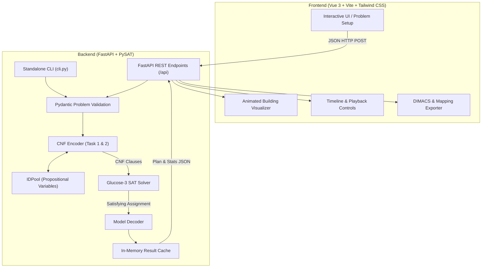

# OptiMove | SAT Logistics Solver

[](https://www.python.org/)
[](https://fastapi.tiangolo.com/)
[](https://pysathq.github.io/)
[](https://vuejs.org/)
[](https://vite.dev/)
[](https://tailwindcss.com/)
[](https://www.docker.com/)

A full-stack web application, command-line interface, and SAT-encoding engine designed to optimally solve the **"Movers" logistics planning problem**. This project formalizes the multi-agent planning problem into **Propositional Conjunctive Normal Form (CNF)** and leverages the **Glucose-3** SAT solver (via `python-sat`) to compute the shortest possible schedule for moving people and items across building floors.

---

## Table of Contents

- [The Problem](#the-problem)
  - [Task 1: Movement Only](#task-1-movement-only)
  - [Task 2: Movement + Carrying (Logistics)](#task-2-movement--carrying-logistics)
- [System Architecture](#system-architecture)
- [Repository Structure](#repository-structure)
- [Quick Start (Docker Compose)](#quick-start-docker-compose)
- [Native Local Setup](#native-local-setup)
  - [1. Backend Setup](#1-backend-setup)
  - [2. Frontend Setup](#2-frontend-setup)
- [Command-Line Interface (CLI)](#command-line-interface-cli)
- [Advanced Engine Features](#advanced-engine-features)
- [Formal SAT Encoding Summary](#formal-sat-encoding-summary)
  - [Variable Families](#variable-families)
  - [Constraint Groups (A–M)](#constraint-groups-a–m)
- [Benchmark Test Scenarios](#benchmark-test-scenarios)
- [Running Automated Tests](#running-automated-tests)
- [Technical Documentation & Report](#technical-documentation--report)

---

## The Problem

Given a building with $N$ floors (indexed $0$ to $N-1$), $M$ movers, and a set of items, find an optimal discrete-time schedule over time steps $t = 0, 1, \dots, T$ that minimizes total time $T$ while satisfying all movement rules and physical constraints.

### Task 1: Movement Only
- All movers start on the ground floor (Floor $0$) at $t = 0$.
- Each mover must reach their designated goal floor at time $T$.
- At each step $t \to t+1$, a mover can **ascend** one floor, **descend** one floor, or stay **idle**.
- Boundary constraints: movers cannot ascend past the top floor ($N-1$) or descend below the ground floor ($0$).

### Task 2: Movement + Carrying (Logistics)
- Extends Task 1 with items placed on various upper floors.
- **Goal:** All movers **and** all items must reach the ground floor (Floor $0$) at time $T$.
- **Downwards-only transport:** Items can only be carried downwards by a descending mover.
- **Capacity:** A mover can carry at most one item at a time. Each item can be carried by at most one mover at a time.
- **Colocation requirement:** A mover and item must occupy the same floor at step $t$ to carry it to the floor below at step $t+1$.
- **Ascent restriction:** A mover carrying an item cannot ascend. Uncarried items stay stationary on their current floor.

---

## System Architecture



- **Frontend (`/frontend`):** Built with Vue 3 (Composition API) and Tailwind CSS v4. Features an animated elevator-shaft visualizer, real-time action logs, variable playback speeds ($1\times, 2\times, 4\times$), and one-click export of DIMACS CNF formulas and variable mappings.
- **Backend (`/backend`):** High-performance Python core using FastAPI and PySAT (`python-sat`). Encodes problem constraints into CNF, solves them with Glucose-3, decodes Boolean models into human-readable actions, and isolates solver executions in child processes to prevent deadlocks.
- **Documentation (`/report`):** Complete technical report detailing theoretical background, formal constraint encodings, complexity analyses, experimental benchmarks, and user guides.

---

## Repository Structure

```
.
├── docker-compose.yml               # Multi-container orchestration (backend + frontend)
├── README.md                        # Master repository documentation (this file)
├── backend/
│   ├── app/
│   │   ├── main.py                  # FastAPI app entry point & CORS configuration
│   │   ├── config.py                # Pydantic BaseSettings (solver, origins, bounds)
│   │   ├── api/
│   │   │   └── routes.py            # REST endpoints (/solve, /fixed, /cnf, /mapping, /health)
│   │   ├── encoding/
│   │   │   ├── variables.py         # Propositional variable definitions & IDPool mapping
│   │   │   ├── common_clauses.py    # AMO (At-Most-One), ALO (At-Least-One), Exactly-One helpers
│   │   │   ├── task1_encoder.py     # Task 1 CNF encoder (Groups A–F)
│   │   │   └── task2_encoder.py     # Task 2 CNF encoder (Groups G–M)
│   │   ├── models/
│   │   │   └── problem.py           # Pydantic request/response/plan domain schemas
│   │   ├── output/
│   │   │   ├── dimacs.py            # DIMACS CNF serializer
│   │   │   └── mapping.py           # Variable mapping JSON serializer
│   │   └── solver/
│   │       ├── runner.py            # Solver runner (fixed horizon & iterative deepening)
│   │       └── decoder.py           # Model decoder (satisfying assignment -> TimeStep plan)
│   ├── cli.py                       # Standalone command-line interface
│   ├── Dockerfile                   # Backend Docker container definition
│   ├── requirements.txt             # Python dependencies
│   ├── tests/                       # Automated pytest test suite (19 tests)
│   └── README.md                    # Backend-specific documentation
├── frontend/
│   ├── src/
│   │   ├── App.vue                  # Root reactive component & state orchestrator
│   │   ├── main.js                  # Frontend entry point
│   │   ├── api/
│   │   │   └── client.js            # API client with timeout and abort handling
│   │   ├── assets/
│   │   │   └── main.css             # Tailwind CSS stylesheets
│   │   └── components/
│   │       ├── ProblemSetup.vue     # Reactive input form for problem parameters
│   │       ├── ResultsPanel.vue     # Results view, playback slider, speed toggles, downloads
│   │       ├── BuildingVisualizer.vue # Multi-floor visualizer
│   │       ├── MoverFigure.vue      # Animated SVG mover figure
│   │       ├── ItemFigure.vue       # Visual item badge
│   │       └── ActionLog.vue        # Step-by-step transition activity log
│   ├── Dockerfile                   # Frontend Docker container definition
│   ├── package.json                 # Node dependencies & npm scripts
│   ├── vite.config.js               # Vite 8 configuration
│   └── README.md                    # Frontend-specific documentation
└── report/
    ├── main.tex                     # LaTeX master document
    ├── main.pdf                     # Compiled technical report
    ├── chapter/                     # 13 LaTeX chapters (Theory, Architecture, Encoding, etc.)
    ├── appendix/                    # Appendices (User guide, API endpoints, file tree)
    └── img/                         # Visualizer screenshots and benchmark diagrams
```

---

## Quick Start (Docker Compose)

The easiest way to run the entire system without managing local Python or Node environments is with **Docker Compose**.

### Prerequisites
- [Docker](https://www.docker.com/) and Docker Compose installed.

### Steps

1. Clone the repository and navigate into the root directory:
   ```bash
   git clone git@github.com:simo-macca/ToC_movers.git
   cd ToC_movers
   ```

2. Build and launch all containers:
   ```bash
   docker-compose up --build
   ```

3. Access the services:
   - **Frontend UI:** [http://localhost:3000](http://localhost:3000)
   - **Backend API Interactive Docs (Swagger):** [http://localhost:8000/docs](http://localhost:8000/docs)
   - **Backend ReDoc:** [http://localhost:8000/redoc](http://localhost:8000/redoc)
   - **API Health Check:** [http://localhost:8000/api/health](http://localhost:8000/api/health)

To shut down the containers, press `Ctrl+C` or run `docker-compose down`.

---

## Native Local Setup

### 1. Backend Setup

**Prerequisites:** Python 3.11 or 3.12.

```bash
cd backend

# Create and activate virtual environment
python3 -m venv .venv
source .venv/bin/activate       # On Windows: .venv\Scripts\activate

# Install dependencies (skip if already installed)
pip install -r requirements.txt

# Start the development server
uvicorn app.main:app --reload --host 0.0.0.0 --port 8000
```

The backend will be available at [http://localhost:8000](http://localhost:8000).

### 2. Frontend Setup

**Prerequisites:** Node.js (`^20.19.0 || >=22.12.0`) and npm.

```bash
cd frontend

# Install dependencies (skip if node_modules already exists)
npm install

# Start Vite development server
npm run dev
```

The frontend will start on port 3000 and be accessible at [http://localhost:3000](http://localhost:3000).

---

## Command-Line Interface (CLI)

The backend includes a standalone CLI ([`backend/cli.py`](backend/cli.py)) allowing you to solve instances directly from your terminal and optionally export CNF formulas.

```bash
cd backend
source .venv/bin/activate
```

### Examples

- **Task 1: 3 movers reaching floor 2**
  ```bash
  python cli.py --floors 3 --persons 3 --names Joe Bill Mia --task 1 --goal-floor 2
  ```

- **Task 2: Fig. 1 benchmark (3 movers, 3 items)**
  ```bash
  python cli.py --floors 3 --persons 3 --names Joe Bill Mia \
    --items flowerpot:2 chair:1 table:2
  ```

- **Task 2: Full Fig. 1 configuration (5 items) with DIMACS export**
  ```bash
  python cli.py --floors 3 --persons 3 --names Joe Bill Mia \
    --items flowerpot:2 chair:1 table:2 piano:1 sofa:2 \
    --cnf-out fig1_solution.cnf
  ```

- **Infeasible Horizon Check (UNSAT at $T=3$)**
  ```bash
  python cli.py --floors 3 --persons 3 \
    --items flowerpot:2 chair:1 table:2 \
    --fixed-t 3
  ```

---

## Advanced Engine Features

- **Iterative Deepening for Guaranteed Optimality:** Explores horizons $T = 0, 1, 2, \dots$ sequentially. The first satisfying assignment found is mathematically guaranteed to be the minimal time horizon $T^*$.
- **Bounded Horizon Testing (Fixed $T$):** Evaluates satisfiability for an exact time bound without searching, proving whether a plan exists in under-constrained horizons.
- **Multiprocessing Worker Isolation:** Solver calls run in dedicated child processes monitored by a 118-second timeout, protecting against SAT solver deadlocks and keeping the API responsive.
- **DIMACS CNF & Variable Mapping Export:** Easily download the generated CNF formula and its variable-to-integer mapping for auditing in external SAT solvers (e.g. CaDiCaL, Kissat, MiniSat).
- **Interactive Timeline Playback:** Scrub through the computed plan step-by-step with synchronized mover positions, item locations, and transition action logs.

---

## Formal SAT Encoding Summary

### Variable Families

All variables are mapped to unique positive integers using PySAT's `IDPool`:

| Variable                       | Scope                                                | Meaning                                             |
|--------------------------------|------------------------------------------------------|-----------------------------------------------------|
| `atFloor(person, floor, time)` | $p \in [0, M-1], f \in [0, N-1], t \in [0, T]$       | Person $p$ is at floor $f$ at time $t$              |
| `atFloor(item, floor, time)`   | $i \in \text{Items}, f \in [0, N-1], t \in [0, T]$   | Item $i$ is at floor $f$ at time $t$                |
| `ascends(person, time)`        | $p \in [0, M-1], t \in [0, T-1]$                     | Person $p$ ascends one floor during $t \to t+1$     |
| `descends(person, time)`       | $p \in [0, M-1], t \in [0, T-1]$                     | Person $p$ descends one floor during $t \to t+1$    |
| `carries(person, item, time)`  | $p \in [0, M-1], i \in \text{Items}, t \in [0, T-1]$ | Person $p$ carries item $i$ down during $t \to t+1$ |

### Constraint Groups (A–M)

| Group | Task   | Name                   | Description                                                                        |
|-------|--------|------------------------|------------------------------------------------------------------------------------|
| **A** | Task 1 | Initial State          | All movers start on floor 0 at $t = 0$.                                            |
| **B** | Task 1 | Goal State             | Movers must be on their target floors at $t = T$.                                  |
| **C** | Task 1 | Unique Floor           | Each mover occupies exactly one floor per time step (ALO + pairwise AMO).          |
| **D** | Task 1 | Action Mutex           | A mover cannot ascend and descend in the same step.                                |
| **E** | Task 1 | Boundary Preconditions | Cannot ascend from top floor ($N-1$); cannot descend from ground floor ($0$).      |
| **F** | Task 1 | Effects & Frame        | Successor-state axioms: mover positions update according to actions or idle state. |
| **G** | Task 2 | Item Initial State     | Items start at their specified floors at $t = 0$.                                  |
| **H** | Task 2 | Item Goal State        | All items must reach floor 0 at $t = T$.                                           |
| **I** | Task 2 | Item Unique Floor      | Each item occupies exactly one floor per time step.                                |
| **J** | Task 2 | Carrying Preconditions | Carrier and item must be collocated; carrying implies descending.                  |
| **K** | Task 2 | Carrying Mutex         | Carrier carries at most one item; item carried by at most one carrier.             |
| **L** | Task 2 | Ascend Precludes Carry | A mover cannot ascend while carrying an item.                                      |
| **M** | Task 2 | Item Successor-State   | Carried items descend by 1 floor; uncarried items remain on their current floor.   |

---

## Benchmark Test Scenarios

The solver has been validated against the following benchmark scenarios:

| #     | Scenario                                  | Configuration                                                                 | Expected Outcome                                                                 |
|-------|-------------------------------------------|-------------------------------------------------------------------------------|----------------------------------------------------------------------------------|
| **1** | **Task 1: Movement to Top Floor**         | $N=3, M=3$, all movers start at 0, goal floor = 2                             | **SAT**, $T^* = 2$<br>All movers ascend at $t=0$ and $t=1$.                      |
| **2** | **Task 2: Three Items (Fig. 1 subset)**   | $N=3, M=3$<br>Items: `flowerpot:2`, `chair:1`, `table:2`                      | **SAT**, $T^* = 4$<br>All movers and items reach floor 0.                        |
| **3** | **Task 2: Full Fig. 1 Configuration**     | $N=3, M=3$<br>Items: `flowerpot:2`, `chair:1`, `table:2`, `piano:1`, `sofa:2` | **SAT**, $T^* = 6$<br>Optimal carrying plan with limited mover capacity.         |
| **4** | **Bounded Solve: Infeasible Horizon**     | Configuration from Scenario 2 with fixed $T = 3$                              | **UNSAT**<br>Cannot retrieve 2 items from floor 2 and 1 from floor 1 in 3 steps. |
| **5** | **Edge Case: Single Mover & Single Item** | $N=2, M=1$, `box:1`                                                           | **SAT**, $T^* = 2$<br>Mover ascends at $t=0$, carries box down at $t=1$.         |

---

## Running Automated Tests

The backend includes 19 automated unit and integration tests written in `pytest`.

To run the suite:

```bash
cd backend
pytest
```

For detailed per-test execution times:

```bash
pytest -v
```

Tests cover:
- Task 1 movement encoding, goal achievement, and action decoding.
- Task 2 logistics, item colocation, carrying preconditions, and frame axioms.
- PySAT `IDPool` consistency and variable naming collisions.
- Full FastAPI endpoint integration (`/api/solve`, `/api/solve/fixed`, `/api/cnf`, `/api/mapping`, `/api/health`).

---

## Technical Documentation & Report

A comprehensive technical report is included in the [`report/`](report/) directory. The report covers:

- **Theoretical Background:** Boolean satisfiability, CNF transformations, and NP-completeness.
- **Formal Encoding:** Detailed mathematical formulas for constraint groups A through M.
- **Complexity Analysis:** Variable count $O(M \cdot N \cdot T + I \cdot N \cdot T)$ and clause growth scaling.
- **Experimental Evaluation:** Runtime performance benchmarks across problem sizes.
- **Design Decisions:** Trade-offs of general CNF vs. 3-CNF, pairwise cardinality encodings, and process isolation.
- **Appendices:** User manual, API reference, and repository file structure.

The compiled report is available directly at [`report/main.pdf`](report/main.pdf).
