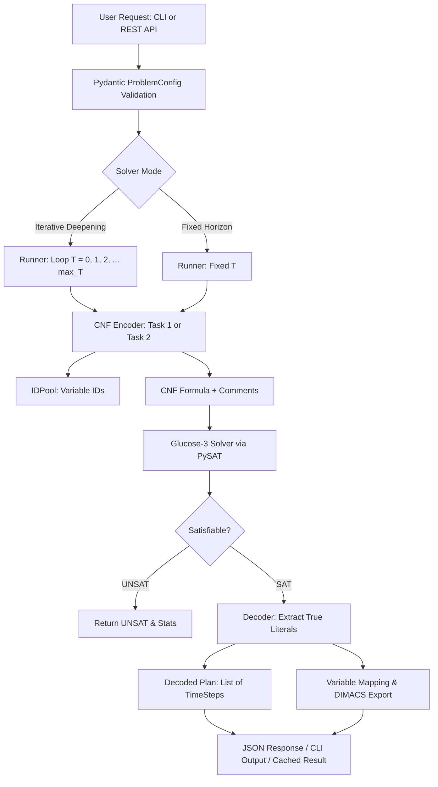

# Movers SAT Solver — Backend

A high-performance Python/FastAPI computational backend that solves the **Movers logistics planning problem** using **Boolean Satisfiability (SAT)**. Given a building with $N$ floors, $M$ movers, and a set of items, the backend encodes the problem into Conjunctive Normal Form (CNF), solves it with the **Glucose-3** SAT solver (via `python-sat`), and decodes the satisfying truth assignments into an optimal, step-by-step logistics plan.

---

## Table of Contents

- [Problem Formalization](#problem-formalization)
  - [Task 1: Movement Only](#task-1-movement-only)
  - [Task 2: Movement + Carrying](#task-2-movement--carrying)
- [SAT Encoding Reference](#sat-encoding-reference)
  - [Propositional Variable Families](#propositional-variable-families)
  - [Constraint Groups (Task 1: A–F)](#constraint-groups-task-1-a-f)
  - [Constraint Groups (Task 2: G–M)](#constraint-groups-task-2-g-m)
- [System Architecture](#system-architecture)
  - [Directory Structure](#directory-structure)
  - [Execution Pipeline](#execution-pipeline)
- [Configuration & Settings](#configuration--settings)
- [Installation & Setup](#installation--setup)
  - [Prerequisites](#prerequisites)
  - [Local Setup](#local-setup)
  - [Running the API Server](#running-the-api-server)
  - [Docker Setup](#docker-setup)
- [CLI Reference](#cli-reference)
- [API Reference](#api-reference)
  - [POST `/api/solve`](#post-apisolve)
  - [POST `/api/solve/fixed`](#post-apisolvefixed)
  - [GET `/api/cnf/{solve_id}`](#get-apicnfsolve_id)
  - [GET `/api/mapping/{solve_id}`](#get-apimappingsolve_id)
  - [GET `/api/health`](#get-apihealth)
- [Testing](#testing)

---

## Problem Formalization

The movers problem models a discrete-time logistics scenario inside a building with floors $0, 1, \dots, N-1$ over time steps $t = 0, 1, \dots, T$.

### Task 1: Movement Only
- $M$ movers start on the ground floor (Floor $0$) at $t = 0$.
- Each mover must reach their designated goal floor at time $T$.
- At each step $t \to t+1$, a mover can:
  - **Ascend** one floor ($\text{floor} + 1$),
  - **Descend** one floor ($\text{floor} - 1$), or
  - Stay **idle** ($\text{floor}$).
- Movers cannot ascend above floor $N-1$ or descend below floor $0$.

### Task 2: Movement + Carrying
- Extends Task 1 with items scattered across upper floors.
- **Goal:** All movers **and** all items must reach floor $0$ at time $T$.
- **Downwards-only carrying:** An item can only move downward if carried by a descending mover.
- **Capacity constraints:** A mover can carry at most one item at a time. Each item can be carried by at most one mover at a time.
- **Colocation requirement:** A mover and item must occupy the exact same floor at step $t$ for the mover to carry it to $\text{floor}-1$ at $t+1$.
- **Ascent restriction:** A mover carrying an item cannot ascend. Uncarried items remain stationary on their floor.

---

## SAT Encoding Reference

### Propositional Variable Families

Propositional variables are registered dynamically using PySAT's `IDPool`:

| Variable                       | Parameters                                           | Symbolic Meaning                                            |
|--------------------------------|------------------------------------------------------|-------------------------------------------------------------|
| `atFloor(person, floor, time)` | $p \in [0, M-1], f \in [0, N-1], t \in [0, T]$       | Person $p$ is at floor $f$ at time $t$                      |
| `atFloor(item, floor, time)`   | $i \in \text{Items}, f \in [0, N-1], t \in [0, T]$   | Item $i$ is at floor $f$ at time $t$                        |
| `ascends(person, time)`        | $p \in [0, M-1], t \in [0, T-1]$                     | Person $p$ ascends one floor during transition $t \to t+1$  |
| `descends(person, time)`       | $p \in [0, M-1], t \in [0, T-1]$                     | Person $p$ descends one floor during transition $t \to t+1$ |
| `carries(person, item, time)`  | $p \in [0, M-1], i \in \text{Items}, t \in [0, T-1]$ | Person $p$ carries item $i$ downwards during $t \to t+1$    |

### Constraint Groups (Task 1: A–F)

Defined in [`app/encoding/task1_encoder.py`](app/encoding/task1_encoder.py):

| Group | Name            | Formulation / Description                                                                                                                                                               |
|-------|-----------------|-----------------------------------------------------------------------------------------------------------------------------------------------------------------------------------------|
| **A** | Initial State   | $\text{atFloor}(p, 0, 0)$ for all $p$.                                                                                                                                                  |
| **B** | Goal State      | $\text{atFloor}(p, \text{goal}(p), T)$ for all $p$.                                                                                                                                     |
| **C** | Unique Floor    | Exactly-one floor per person at each time step: $\text{ALO} \land \text{AMO}(\{\text{atFloor}(p, f, t) \mid f\})$.                                                                      |
| **D** | Action Mutex    | At-most-one action per step: $\neg \text{ascends}(p, t) \lor \neg \text{descends}(p, t)$.                                                                                               |
| **E** | Preconditions   | Cannot ascend from top floor: $\text{atFloor}(p, N-1, t) \to \neg \text{ascends}(p, t)$.<br>Cannot descend from ground floor: $\text{atFloor}(p, 0, t) \to \neg \text{descends}(p, t)$. |
| **F** | Effects & Frame | Successor-state axioms for mover positions: moving up, moving down, or remaining idle preserves floor.                                                                                  |

### Constraint Groups (Task 2: G–M)

Defined in [`app/encoding/task2_encoder.py`](app/encoding/task2_encoder.py) (augments Groups A–F):

| Group | Name                   | Formulation / Description                                                                                                                                                                                      |
|-------|------------------------|----------------------------------------------------------------------------------------------------------------------------------------------------------------------------------------------------------------|
| **G** | Item Initial State     | $\text{atFloor}(i, \text{init\_floor}(i), 0)$ for all items $i$.                                                                                                                                               |
| **H** | Item Goal State        | $\text{atFloor}(i, 0, T)$ for all items $i$.                                                                                                                                                                   |
| **I** | Item Unique Floor      | Exactly-one floor per item at each time step: $\text{ALO} \land \text{AMO}(\{\text{atFloor}(i, f, t) \mid f\})$.                                                                                               |
| **J** | Carrying Preconditions | Carrier and item must be co-located: $\text{carries}(p, i, t) \land \text{atFloor}(p, f, t) \to \text{atFloor}(i, f, t)$.<br>Carrying implies descending: $\text{carries}(p, i, t) \to \text{descends}(p, t)$. |
| **K** | Carrying Mutex         | Each mover carries at most one item: $\text{AMO}(\{\text{carries}(p, i, t) \mid i\})$.<br>Each item carried by at most one mover: $\text{AMO}(\{\text{carries}(p, i, t) \mid p\})$.                            |
| **L** | Ascend Precludes Carry | A mover cannot ascend while carrying: $\text{ascends}(p, t) \to \neg \text{carries}(p, i, t)$.                                                                                                                 |
| **M** | Item Successor-State   | If item $i$ is carried from floor $f$, it moves to $f-1$. If not carried, it remains at floor $f$.                                                                                                             |

---

## System Architecture

### Directory Structure

```
backend/
├── app/
│   ├── __init__.py
│   ├── main.py                  # FastAPI application entry point, CORS configuration
│   ├── config.py                # Runtime configuration (Settings via pydantic-settings)
│   ├── api/
│   │   ├── __init__.py
│   │   └── routes.py            # REST API endpoints, multiprocessing isolation, caching
│   ├── encoding/
│   │   ├── __init__.py
│   │   ├── common_clauses.py    # Cardinality combinators: AMO, ALO, Exactly-One
│   │   ├── task1_encoder.py     # Task 1 CNF encoding (Groups A–F)
│   │   ├── task2_encoder.py     # Task 2 CNF encoding (Groups G–M)
│   │   └── variables.py         # Propositional variable factories & name mapping
│   ├── models/
│   │   ├── __init__.py
│   │   └── problem.py           # Pydantic schemas (requests, responses, plan representations)
│   ├── output/
│   │   ├── __init__.py
│   │   ├── dimacs.py            # DIMACS CNF serializer with comment headers
│   │   └── mapping.py           # Variable ID <-> symbolic name JSON serializer
│   └── solver/
│       ├── __init__.py
│       ├── runner.py            # Solver orchestration (fixed horizon & iterative deepening)
│       └── decoder.py           # Decodes satisfying SAT assignment into step-by-step plan
├── tests/
│   ├── __init__.py
│   ├── test_api.py              # API endpoint integration tests
│   ├── test_task1.py            # Task 1 encoding correctness tests
│   ├── test_task2.py            # Task 2 encoding correctness tests
│   └── test_variables.py        # IDPool consistency and variable mapping tests
├── cli.py                       # Standalone command-line interface
├── Dockerfile                   # Container definition for the backend
└── requirements.txt             # Python dependencies
```

### Execution Pipeline



---

## Configuration & Settings

Settings are managed via `pydantic-settings` in [`app/config.py`](app/config.py) and can be configured through environment variables:

| Variable         | Type        | Default                                              | Description                                                  |
|------------------|-------------|------------------------------------------------------|--------------------------------------------------------------|
| `SOLVER_NAME`    | string      | `"g3"`                                               | PySAT solver identifier (`"g3"` = Glucose-3).                |
| `MAX_TIME_STEPS` | integer     | `20`                                                 | Default upper bound on $T$ for iterative deepening searches. |
| `CORS_ORIGINS`   | list / JSON | `["http://localhost:5173", "http://localhost:3000"]` | Allowed CORS origins for the frontend.                       |

### Process Isolation & Deadlock Protection
In [`app/api/routes.py`](app/api/routes.py), solver executions run in an isolated `multiprocessing.Process` governed by `SOLVER_TIMEOUT_SECONDS = 118.0`. This prevents PySAT C-extension deadlocks from blocking the ASGI worker thread. If the timeout expires, the child process is terminated with a `504 Gateway Timeout`.

---

## Installation & Setup

### Prerequisites
- Python 3.11 or Python 3.12
- `pip` or modern Python package manager (`uv`, `pipenv`, etc.)

### Local Setup

1. Create and activate a virtual environment:
   ```bash
   cd backend
   python3 -m venv .venv
   source .venv/bin/activate       # macOS / Linux
   # .venv\Scripts\activate        # Windows PowerShell
   ```

2. Install dependencies:
   ```bash
   pip install -r requirements.txt
   ```

*(If `.venv` already exists with dependencies installed, simply activate it with `source .venv/bin/activate`).*

### Running the API Server

Start Uvicorn with auto-reload:
```bash
uvicorn app.main:app --reload --host 0.0.0.0 --port 8000
```

- **Interactive API Documentation (Swagger UI):** [http://localhost:8000/docs](http://localhost:8000/docs)
- **ReDoc Documentation:** [http://localhost:8000/redoc](http://localhost:8000/redoc)
- **Health Check:** [http://localhost:8000/api/health](http://localhost:8000/api/health)

### Docker Setup

Build and run the backend container standalone:
```bash
docker build -t movers-backend .
docker run -p 8000:8000 movers-backend
```

*(Or orchestrate frontend + backend together using `docker-compose up --build` from the repository root).*

---

## CLI Reference

[`cli.py`](cli.py) provides a direct terminal interface for running experiments without starting the web server.

### Arguments

| Flag           | Type             | Description                                                           |
|----------------|------------------|-----------------------------------------------------------------------|
| `--floors`     | `int` (required) | Total number of building floors ($0$ to $N-1$).                       |
| `--persons`    | `int` (required) | Number of movers.                                                     |
| `--names`      | `string...`      | Optional names for movers (e.g. `--names Joe Bill Mia`).              |
| `--items`      | `string...`      | Items as `name:floor` pairs (e.g. `--items chair:1 table:2`).         |
| `--task`       | `1 \| 2`         | Force Task 1 or 2 (auto-detected as 2 if `--items` provided, else 1). |
| `--goal-floor` | `int`            | Task 1: target floor for all movers (default: 0).                     |
| `--fixed-t`    | `int`            | Solve for an exact horizon $T$ instead of iterative deepening.        |
| `--max-t`      | `int`            | Max time horizon for iterative deepening (default: 20).               |
| `--cnf-out`    | `string`         | Export the resulting CNF formula to a `.cnf` file in DIMACS format.   |

### CLI Examples

**1. Task 1: 3 movers reaching floor 2**
```bash
python cli.py --floors 3 --persons 3 --names Joe Bill Mia --task 1 --goal-floor 2
```

**2. Task 2: Canonical Fig. 1 problem (3 movers, 3 items)**
```bash
python cli.py --floors 3 --persons 3 --names Joe Bill Mia \
  --items flowerpot:2 chair:1 table:2
```

**3. Task 2: Full Fig. 1 benchmark (5 items, saving DIMACS formula)**
```bash
python cli.py --floors 3 --persons 3 --names Joe Bill Mia \
  --items flowerpot:2 chair:1 table:2 piano:1 sofa:2 \
  --cnf-out fig1_problem.cnf
```

**4. Bounded solve at fixed $T=3$ (Expected UNSAT)**
```bash
python cli.py --floors 3 --persons 3 \
  --items flowerpot:2 chair:1 table:2 \
  --fixed-t 3
```

---

## API Reference

All routes are mounted under `/api`.

### POST `/api/solve`
Computes the optimal (minimal $T$) solution via iterative deepening ($T = 0, 1, 2, \dots$).

**Request Body (Task 2 Example):**
```json
{
  "task": 2,
  "num_floors": 3,
  "num_persons": 3,
  "person_names": ["Joe", "Bill", "Mia"],
  "items": [
    {"name": "flowerpot", "initial_floor": 2},
    {"name": "chair", "initial_floor": 1},
    {"name": "table", "initial_floor": 2}
  ],
  "max_steps": 20
}
```

**Request Body (Task 1 Example):**
```json
{
  "task": 1,
  "num_floors": 3,
  "num_persons": 3,
  "person_names": ["Joe", "Bill", "Mia"],
  "goal_floors": {"0": 2, "1": 2, "2": 2},
  "max_steps": 10
}
```

**Response (`200 OK`):**
```json
{
  "solve_id": "8489cf5b-7b0b-4861-ae02-e25fcf95eb78",
  "result": {
    "satisfiable": true,
    "num_time_steps": 4,
    "plan": [
      {
        "t": 0,
        "actions": [
          {"person": "Joe", "action": "ascends", "from_floor": 0, "to_floor": 1, "item": null},
          {"person": "Bill", "action": "ascends", "from_floor": 0, "to_floor": 1, "item": null},
          {"person": "Mia", "action": "ascends", "from_floor": 0, "to_floor": 1, "item": null}
        ],
        "person_positions": {"Joe": 0, "Bill": 0, "Mia": 0},
        "item_positions": {"flowerpot": 2, "chair": 1, "table": 2}
      }
    ],
    "cnf_dimacs": "c DIMACS CNF generated by Movers SAT Solver\np cnf 138 684\n...",
    "variable_mapping": {
      "1": "atFloor(Joe, 0, 0)",
      "2": "atFloor(Joe, 1, 0)"
    },
    "stats": {
      "num_variables": 138,
      "num_clauses": 684,
      "solve_time_ms": 3.42
    }
  }
}
```

### POST `/api/solve/fixed`
Solves for an exact horizon $T$ (useful for verifying infeasibility or step-bounded planning).

**Request Body:**
Includes all fields from `POST /api/solve`, plus `"time_steps": int`.
```json
{
  "task": 2,
  "num_floors": 3,
  "num_persons": 3,
  "items": [
    {"name": "flowerpot", "initial_floor": 2},
    {"name": "chair", "initial_floor": 1},
    {"name": "table", "initial_floor": 2}
  ],
  "time_steps": 3
}
```

**Response (UNSAT example):**
```json
{
  "solve_id": "c6a2ef18-500b-4395-8869-70014b2d3bf3",
  "result": {
    "satisfiable": false,
    "num_time_steps": 3,
    "plan": null,
    "cnf_dimacs": null,
    "variable_mapping": null,
    "stats": {
      "num_variables": 105,
      "num_clauses": 508,
      "solve_time_ms": 1.85
    }
  }
}
```

### GET `/api/cnf/{solve_id}`
Retrieves the raw DIMACS CNF representation of the problem for a previous satisfiable solve.
- **Response:** `{"cnf": "p cnf ...\n..."}`
- **Error:** `404 Not Found` if `solve_id` is invalid or the instance was UNSAT.

### GET `/api/mapping/{solve_id}`
Retrieves the mapping dictionary `{variable_id: symbolic_name}` for a previous satisfiable solve.
- **Response:** `{"mapping": {"1": "atFloor(Joe, 0, 0)", ...}}`

### GET `/api/health`
Basic service health check:
```json
{
  "status": "ok",
  "solver": "glucose3"
}
```

---

## Testing

The backend includes a comprehensive `pytest` test suite covering SAT encoding logic, variable generation, API routing, and boundary conditions.

### Running Tests

Activate the virtual environment and execute:
```bash
cd backend
pytest
```

To run with verbose output:
```bash
pytest -v
```

### Test Suite Structure

| Test File                                            | Covered Functionality                                                                                                                                                                               |
|------------------------------------------------------|-----------------------------------------------------------------------------------------------------------------------------------------------------------------------------------------------------|
| [`tests/test_task1.py`](tests/test_task1.py)         | Verification that 3 movers reach floor 2 in exactly 2 steps, verification of UNSAT at $T=1$, edge cases (trivial $T=0$), and plan action verification (`ascends`).                                  |
| [`tests/test_task2.py`](tests/test_task2.py)         | Full logistics solving: 3-item setup optimal at $T=4$, UNSAT at $T=3$, full 5-item Fig. 1 benchmark optimal at $T=6$, single-mover single-item edge cases, and final state ground-floor validation. |
| [`tests/test_variables.py`](tests/test_variables.py) | `IDPool` variable consistency, uniqueness across distinct propositional variable families, and human-readable string mapping generation.                                                            |
| [`tests/test_api.py`](tests/test_api.py)             | End-to-end FastAPI integration testing via `TestClient`: health endpoint, `/solve` for Task 1 and Task 2, `/cnf/{solve_id}`, `/mapping/{solve_id}`, and 404 handling.                               |
