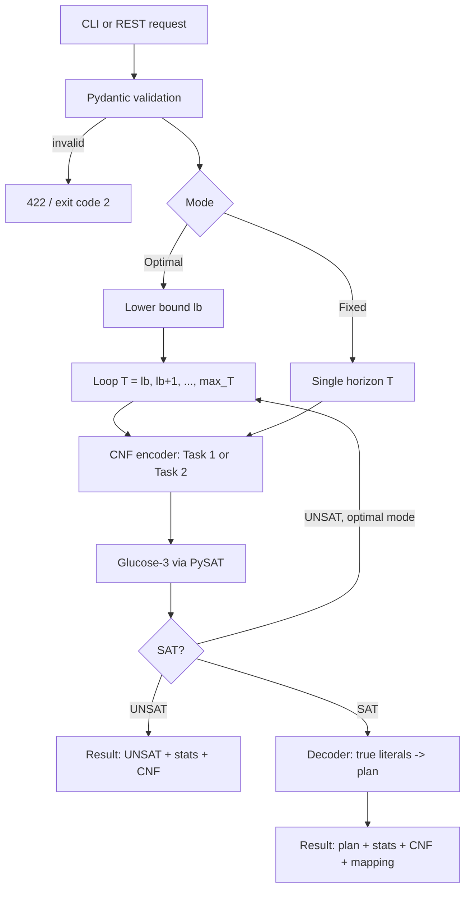

# OptiMove Backend: Movers SAT Solver

The Python/FastAPI backend of [OptiMove](../README.md). Given a building with $N$ floors, $M$ movers and a set of
items, it encodes the **Movers planning problem** into Conjunctive Normal Form (CNF), solves it with the
**Glucose-3** SAT solver (via `python-sat`), and decodes the satisfying assignment into an optimal, step-by-step plan.
It is available as a REST API and as a command-line tool.

---

## Table of Contents

- [Problem Formalization](#problem-formalization)
- [SAT Encoding Reference](#sat-encoding-reference)
  - [Propositional Variable Families](#propositional-variable-families)
  - [Constraint Groups: Task 1 (A to F)](#constraint-groups-task-1-a-to-f)
  - [Constraint Groups: Task 2 (G to M)](#constraint-groups-task-2-g-to-m)
- [How Solving Works](#how-solving-works)
- [Directory Structure](#directory-structure)
- [Configuration](#configuration)
- [Installation & Setup](#installation--setup)
- [CLI Reference](#cli-reference)
- [API Reference](#api-reference)
- [Testing](#testing)

---

## Problem Formalization

The movers problem models a discrete-time logistics scenario inside a building with floors $0, 1, \dots, N-1$ over time steps $t = 0, 1, \dots, T$.

### Task 1: Movement Only

- $M$ movers start on the ground floor (Floor $0$) at $t = 0$.
- Each mover must reach their designated goal floor at time $T$.
- At each step $t \to t+1$, a mover can:
  - **Ascend** one floor ($\text{floor} + 1$),
  - **Descend** one floor ($\text{floor} - 1$), or
  - Stay **idle** ($\text{floor}$).
- Movers cannot ascend above floor $N-1$ or descend below floor $0$.

### Task 2: Movement + Carrying

- Extends Task 1 with items scattered across upper floors.
- **Goal:** All movers **and** all items must reach floor $0$ at time $T$.
- **Downwards-only carrying:** An item can only move downward if carried by a descending mover.
- **Capacity constraints:** A mover can carry at most one item at a time. Each item can be carried by at most one mover at a time.
- **Colocation requirement:** A mover and item must occupy the exact same floor at step $t$ for the mover to carry it to $\text{floor}-1$ at $t+1$.
- **Ascent restriction:** A mover carrying an item cannot ascend. Uncarried items remain stationary on their floor.

---

## SAT Encoding Reference

### Propositional Variable Families

Propositional variables are registered dynamically using PySAT's `IDPool`:

| Variable                       | Parameters                                           | Symbolic Meaning                                            |
|--------------------------------|------------------------------------------------------|-------------------------------------------------------------|
| `atFloor(person, floor, time)` | $p \in [0, M-1], f \in [0, N-1], t \in [0, T]$       | Person $p$ is at floor $f$ at time $t$                      |
| `atFloor(item, floor, time)`   | $i \in \text{Items}, f \in [0, N-1], t \in [0, T]$   | Item $i$ is at floor $f$ at time $t$                        |
| `ascends(person, time)`        | $p \in [0, M-1], t \in [0, T-1]$                     | Person $p$ ascends one floor during transition $t \to t+1$  |
| `descends(person, time)`       | $p \in [0, M-1], t \in [0, T-1]$                     | Person $p$ descends one floor during transition $t \to t+1$ |
| `carries(person, item, time)`  | $p \in [0, M-1], i \in \text{Items}, t \in [0, T-1]$ | Person $p$ carries item $i$ downwards during $t \to t+1$    |

### Constraint Groups: Task 1 (A to F)

Defined in [`app/encoding/task1_encoder.py`](app/encoding/task1_encoder.py):

| Group | Name            | Formulation / Description                                                                                                                                                               |
|-------|-----------------|-----------------------------------------------------------------------------------------------------------------------------------------------------------------------------------------|
| **A** | Initial State   | $\text{atFloor}(p, 0, 0)$ for all $p$.                                                                                                                                                  |
| **B** | Goal State      | $\text{atFloor}(p, \text{goal}(p), T)$ for all $p$.                                                                                                                                     |
| **C** | Unique Floor    | Exactly-one floor per person at each time step: $\text{ALO} \land \text{AMO}(\{\text{atFloor}(p, f, t) \mid f\})$.                                                                      |
| **D** | Action Mutex    | At-most-one action per step: $\neg \text{ascends}(p, t) \lor \neg \text{descends}(p, t)$.                                                                                               |
| **E** | Preconditions   | Cannot ascend from top floor: $\text{atFloor}(p, N-1, t) \to \neg \text{ascends}(p, t)$.<br>Cannot descend from ground floor: $\text{atFloor}(p, 0, t) \to \neg \text{descends}(p, t)$. |
| **F** | Effects & Frame | Successor-state axioms for mover positions: moving up, moving down, or remaining idle preserves floor.                                                                                  |

### Constraint Groups: Task 2 (G to M)

Defined in [`app/encoding/task2_encoder.py`](app/encoding/task2_encoder.py) (augments Groups A–F):

| Group | Name                   | Formulation / Description                                                                                                                                                                                      |
|-------|------------------------|----------------------------------------------------------------------------------------------------------------------------------------------------------------------------------------------------------------|
| **G** | Item Initial State     | $\text{atFloor}(i, \text{init\_floor}(i), 0)$ for all items $i$.                                                                                                                                               |
| **H** | Item Goal State        | $\text{atFloor}(i, 0, T)$ for all items $i$.                                                                                                                                                                   |
| **I** | Item Unique Floor      | Exactly-one floor per item at each time step: $\text{ALO} \land \text{AMO}(\{\text{atFloor}(i, f, t) \mid f\})$.                                                                                               |
| **J** | Carrying Preconditions | Carrier and item must be co-located: $\text{carries}(p, i, t) \land \text{atFloor}(p, f, t) \to \text{atFloor}(i, f, t)$.<br>Carrying implies descending: $\text{carries}(p, i, t) \to \text{descends}(p, t)$. |
| **K** | Carrying Mutex         | Each mover carries at most one item: $\text{AMO}(\{\text{carries}(p, i, t) \mid i\})$.<br>Each item carried by at most one mover: $\text{AMO}(\{\text{carries}(p, i, t) \mid p\})$.                            |
| **L** | Ascend Precludes Carry | A mover cannot ascend while carrying: $\text{ascends}(p, t) \to \neg \text{carries}(p, i, t)$.                                                                                                                 |
| **M** | Item Successor-State   | If item $i$ is carried from floor $f$, it moves to $f-1$. If not carried, it remains at floor $f$.                                                                                                             |

---

## How Solving Works



### Optimal search with a lower bound

`solve_optimal` runs `solve_fixed` for increasing $T$ and returns the first satisfiable horizon. It does not start
at $T = 0$ but at a provable lower bound, because every smaller $T$ is guaranteed UNSAT:

- **Task 1:** movers climb at most one floor per step, so $T^* \ge \max(\text{goal floor})$.
- **Task 2:** an item on floor $f$ cannot move before a mover has climbed to $f$ (at least $f$ steps), and then needs
  $f$ carry steps, so $T^* \ge 2 \cdot \max(\text{item floor})$.

The result is still optimal; only horizons that cannot work are skipped. `stats.horizons_tried` reports how many
formulas were actually solved, and `stats.solve_time_ms` is the total time across them.

### Process isolation and timeout

Each API solve runs in a separate child process (started with `spawn`) that sends its result back over a queue.
If it does not finish within `SOLVER_TIMEOUT_SECONDS` (default 118 s), the process is terminated and the API answers
`504 Gateway Timeout`. If the process crashes, the API answers `500` straight away instead of waiting for the
timeout. The handlers are synchronous, so FastAPI runs them in its thread pool and other requests are never blocked.

### Result cache

Results are kept in a thread-safe, in-memory **LRU cache** (`RESULT_CACHE_SIZE` entries, default 128) so the CNF
and mapping can be downloaded after the solve. The cache does not survive restarts and is per process. This is
why the production image runs a single uvicorn worker.

---

## Directory Structure

```
backend/
├── app/
│   ├── __init__.py              # Package version
│   ├── main.py                  # FastAPI app, CORS
│   ├── config.py                # Settings via pydantic-settings (env variables)
│   ├── api/
│   │   └── routes.py            # REST endpoints, process isolation, LRU cache
│   ├── encoding/
│   │   ├── common_clauses.py    # AMO, ALO, Exactly-One
│   │   ├── task1_encoder.py     # Groups A–F
│   │   ├── task2_encoder.py     # Groups G–M
│   │   └── variables.py         # Variable factories & name mapping
│   ├── models/
│   │   ├── problem.py           # Domain models + validation (ProblemConfig, SolverResult, ...)
│   │   └── api.py               # Request/response schemas (SolveRequest, FixedSolveRequest, ...)
│   ├── output/
│   │   ├── dimacs.py            # DIMACS CNF serializer (with mapping comments)
│   │   └── mapping.py           # Mapping -> JSON (CLI --mapping-out)
│   └── solver/
│       ├── runner.py            # solve_fixed, solve_optimal, horizon_lower_bound
│       ├── decoder.py           # Model -> list of TimeStep
│       └── worker.py            # Entry point of the isolated solver process
├── tests/
│   ├── test_task1.py            # Task 1 encoding
│   ├── test_task2.py            # Task 2 encoding and benchmarks
│   ├── test_variables.py        # IDPool consistency, mapping names
│   ├── test_api.py              # REST endpoints
│   ├── test_validation.py       # Rejected inputs (422)
│   └── test_improvements.py     # Lower bound, UNSAT export, cache, timeout, CLI
├── cli.py
├── Dockerfile                   # Targets: dev (reload) and prod (non-root)
├── pyproject.toml
├── requirements.txt             # Runtime dependencies
└── requirements-dev.txt         # Runtime + pytest, httpx
```

---

## Configuration

All settings live in [`app/config.py`](app/config.py) and can be overridden with environment variables
(case-insensitive):

| Variable                 | Type       | Default                                              | Description                                                                      |
|--------------------------|------------|------------------------------------------------------|----------------------------------------------------------------------------------|
| `SOLVER_NAME`            | string     | `g3`                                                 | PySAT solver alias, validated at startup. E.g. `g3`, `g4`, `cd19`, `m22`, `mcb`. |
| `MAX_TIME_STEPS`         | integer    | `20`                                                 | Default upper bound on $T$ for iterative deepening.                              |
| `SOLVER_TIMEOUT_SECONDS` | float      | `118.0`                                              | Hard limit per API solve. Keep it below the frontend timeout (120 s).            |
| `RESULT_CACHE_SIZE`      | integer    | `128`                                                | Number of recent results kept for CNF and mapping downloads.                     |
| `CORS_ORIGINS`           | JSON list  | `["http://localhost:5173", "http://localhost:3000"]` | Allowed browser origins.                                                         |

Example: `SOLVER_NAME=cd19 SOLVER_TIMEOUT_SECONDS=60 uvicorn app.main:app`.

---

## Installation & Setup

**Prerequisites:** Python 3.11 or newer.

```bash
cd backend
python3 -m venv .venv
source .venv/bin/activate            # Windows: .venv\Scripts\activate
pip install -r requirements-dev.txt  # or: pip install -r requirements.txt (runtime only)
```

Alternatively, install the package itself, which also adds an `optimove` command that runs the CLI:

```bash
pip install -e ".[dev]"
```

### Running the API server

```bash
uvicorn app.main:app --reload --host 0.0.0.0 --port 8000
```

- Swagger UI: [http://localhost:8000/docs](http://localhost:8000/docs)
- ReDoc: [http://localhost:8000/redoc](http://localhost:8000/redoc)
- Health: [http://localhost:8000/api/health](http://localhost:8000/api/health)

### Docker

```bash
docker build --target dev  -t optimove-backend:dev  .   # auto-reload
docker build --target prod -t optimove-backend:prod .   # non-root, no reload
docker run -p 8000:8000 optimove-backend:prod
```

Or run the full stack from the repository root with `docker compose up --build`.

---

## CLI Reference

[`cli.py`](cli.py) solves instances without starting the web server. It uses the same validation as the API.

| Flag            | Type             | Description                                                              |
|-----------------|------------------|--------------------------------------------------------------------------|
| `--floors`      | `int` (required) | Number of floors ($0$ to $N-1$).                                         |
| `--persons`     | `int` (required) | Number of movers.                                                        |
| `--names`       | `str...`         | Mover names, one per mover (e.g. `--names Joe Bill Mia`).                |
| `--items`       | `str...`         | Items as `name:floor` pairs (e.g. `--items chair:1 table:2`).            |
| `--task`        | `1 \| 2`         | Force Task 1 or 2 (default: 2 if `--items` is given, else 1).            |
| `--goal-floor`  | `int`            | Task 1: target floor for all movers (default: 0).                        |
| `--fixed-t`     | `int`            | Solve for an exact horizon $T$ instead of searching for the optimum.     |
| `--max-t`       | `int`            | Upper bound for iterative deepening (default: `MAX_TIME_STEPS`, 20).     |
| `--cnf-out`     | `path`           | Write the DIMACS CNF (also for UNSAT results).                           |
| `--mapping-out` | `path`           | Write the variable ID -> name mapping as JSON.                           |

**Exit codes:** `0` satisfiable, `1` unsatisfiable, `2` invalid input.

### Examples

```bash
# 1. Task 1: 3 movers reach floor 2
python cli.py --floors 3 --persons 3 --names Joe Bill Mia --task 1 --goal-floor 2

# 2. Task 2: Fig. 1 (3 movers, 3 items) -> T* = 4
python cli.py --floors 3 --persons 3 --names Joe Bill Mia --items flowerpot:2 chair:1 table:2

# 3. Task 2: full Fig. 1 (5 items) -> T* = 6, with exports
python cli.py --floors 3 --persons 3 --names Joe Bill Mia \
  --items flowerpot:2 chair:1 table:2 piano:1 sofa:2 \
  --cnf-out fig1.cnf --mapping-out fig1.json

# 4. Fixed T = 3 -> UNSAT; the CNF is still written
python cli.py --floors 3 --persons 3 --items flowerpot:2 chair:1 table:2 --fixed-t 3 --cnf-out unsat.cnf
```

---

## API Reference

All routes are mounted under `/api`. Interactive documentation is at `/docs`.

### POST `/api/solve`

Finds the optimal (minimum $T$) plan via iterative deepening from the lower bound.

**Request (Task 2):**

```json
{
  "task": 2,
  "num_floors": 3,
  "num_persons": 3,
  "person_names": ["Joe", "Bill", "Mia"],
  "items": [
    {"name": "flowerpot", "initial_floor": 2},
    {"name": "chair", "initial_floor": 1},
    {"name": "table", "initial_floor": 2}
  ],
  "max_steps": 20
}
```

**Request (Task 1):**

```json
{
  "task": 1,
  "num_floors": 3,
  "num_persons": 3,
  "person_names": ["Joe", "Bill", "Mia"],
  "goal_floors": {"0": 2, "1": 2, "2": 2},
  "max_steps": 10
}
```

**Request fields and validation:**

| Field          | Type                        | Rules                                                                                          |
|----------------|-----------------------------|------------------------------------------------------------------------------------------------|
| `task`         | `1` or `2`                  | Required.                                                                                      |
| `num_floors`   | int                         | 1 to 50.                                                                                       |
| `num_persons`  | int                         | 1 to 20.                                                                                       |
| `person_names` | list of str, optional       | Exactly `num_persons` names, unique and non-empty.                                             |
| `items`        | list, optional              | Task 2 only (ignored for Task 1). Unique names, `0 <= initial_floor < num_floors`, at most 50. |
| `goal_floors`  | object, optional            | Task 1 only. Keys: person indices; values: floors in range. Default: floor 0.                  |
| `max_steps`    | int, optional               | 0 to 100. Default: `MAX_TIME_STEPS`.                                                           |

**Response `200 OK`** (plan shortened):

```json
{
  "solve_id": "fa021e4f-1b2f-4de7-b68a-f3dd9278a8f2",
  "result": {
    "satisfiable": true,
    "num_time_steps": 4,
    "plan": [
      {
        "t": 0,
        "actions": [
          {"person": "Joe",  "action": "idle",    "from_floor": 0, "to_floor": 0, "item": null},
          {"person": "Bill", "action": "ascends", "from_floor": 0, "to_floor": 1, "item": null},
          {"person": "Mia",  "action": "ascends", "from_floor": 0, "to_floor": 1, "item": null}
        ],
        "person_positions": {"Joe": 0, "Bill": 0, "Mia": 0},
        "item_positions": {"flowerpot": 2, "chair": 1, "table": 2}
      }
    ],
    "stats": {
      "num_variables": 150,
      "num_clauses": 624,
      "solve_time_ms": 0.4,
      "horizons_tried": 1
    }
  }
}
```

Each `plan[t]` holds the positions **at** time $t$ and the actions during $t \to t+1$ (empty at the last step).
`action` is one of `idle`, `ascends`, `descends` or `carries`. The CNF and mapping are not included in the response
to keep it small; download them with the endpoints below.

If no plan exists up to `max_steps`, the result has `satisfiable: false`, `plan: null`, and `num_time_steps` is the
last horizon tested.

**Response `422 Unprocessable Entity`** (invalid input):

```json
{
  "detail": [
    {
      "type": "value_error",
      "loc": ["body"],
      "msg": "Value error, item 'box' starts on floor 5, but floors range from 0 to 2"
    }
  ]
}
```

**Other errors:** `504` solver timeout exceeded, `500` solver error.

### POST `/api/solve/fixed`

Solves for an exact horizon $T$. Useful to prove that no plan of a given length exists.

Accepts all fields of `/api/solve` plus `"time_steps": int` (0 to 100):

```json
{
  "task": 2,
  "num_floors": 3,
  "num_persons": 3,
  "items": [
    {"name": "flowerpot", "initial_floor": 2},
    {"name": "chair", "initial_floor": 1},
    {"name": "table", "initial_floor": 2}
  ],
  "time_steps": 3
}
```

**Response (UNSAT):**

```json
{
  "solve_id": "616c72de-edb9-409d-9f02-87544dd95435",
  "result": {
    "satisfiable": false,
    "num_time_steps": 3,
    "plan": null,
    "stats": {"num_variables": 117, "num_clauses": 480, "solve_time_ms": 0.28, "horizons_tried": 1}
  }
}
```

### GET `/api/cnf/{solve_id}`

Returns the DIMACS CNF of a previous solve, **SAT or UNSAT**. Variable names are listed as `c` comment lines.

- **Response:** `{"cnf": "c 1 = atFloor(Joe, 0, 0)\n...\np cnf 150 624\n..."}`
- **Error:** `404` if the `solve_id` is unknown or was evicted from the cache.

### GET `/api/mapping/{solve_id}`

Returns the mapping `{variable_id: symbolic_name}` of a previous solve.

- **Response:** `{"mapping": {"1": "atFloor(Joe, 0, 0)", ...}}`
- **Error:** `404` as above.

### GET `/api/health`

```json
{"status": "ok", "solver": "glucose3", "version": "1.1.0"}
```

`solver` is the canonical name of the configured `SOLVER_NAME`.

---

## Testing

```bash
cd backend
pytest        # or: pytest -v
```

| Test file                                                  | What it covers                                                                                                |
|------------------------------------------------------------|---------------------------------------------------------------------------------------------------------------|
| [`tests/test_task1.py`](tests/test_task1.py)               | 3 movers reach floor 2 in 2 steps, UNSAT at $T=1$, trivial $T=0$, decoded `ascends` actions.                  |
| [`tests/test_task2.py`](tests/test_task2.py)               | 3-item benchmark ($T^*=4$), UNSAT at $T=3$, full Fig. 1 ($T^*=6$), single mover/item, final state on floor 0. |
| [`tests/test_variables.py`](tests/test_variables.py)       | `IDPool` consistency, distinct variable families, readable mapping names.                                     |
| [`tests/test_api.py`](tests/test_api.py)                   | `/health`, `/solve` for both tasks, `/cnf`, `/mapping`, 404 handling.                                         |
| [`tests/test_validation.py`](tests/test_validation.py)     | Invalid task, counts, floors, duplicate names, goal floors, horizons: all return 422.                         |
| [`tests/test_improvements.py`](tests/test_improvements.py) | Lower bound validity, UNSAT CNF export, stats, LRU cache, timeout (504), CLI exports and exit codes.          |
