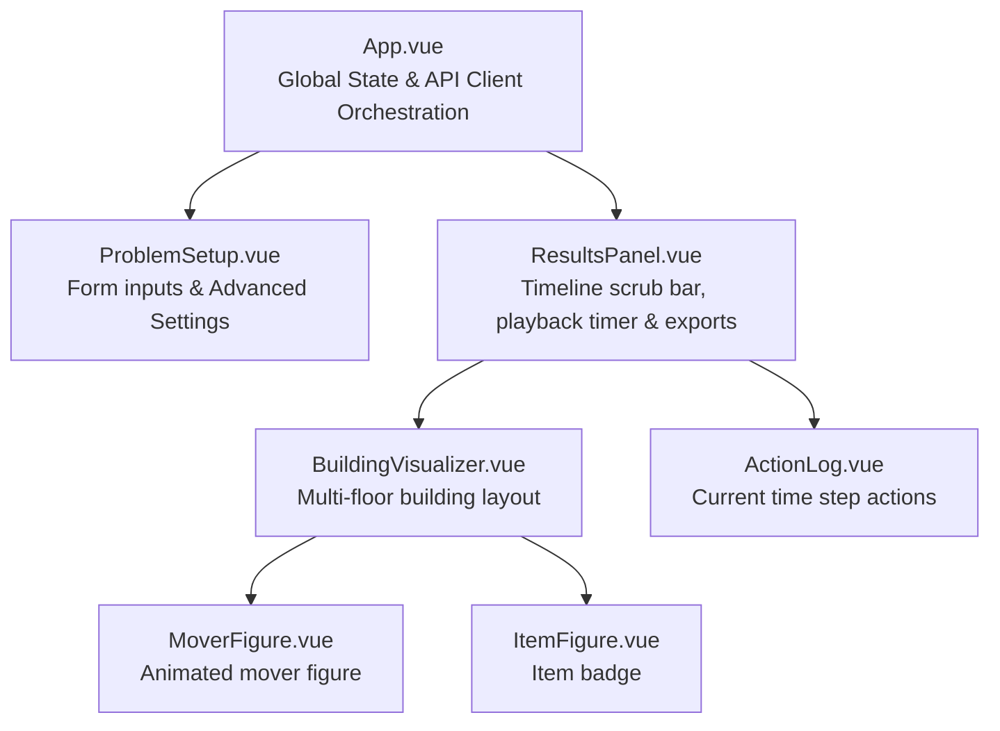

# OptiMove | SAT Logistics Frontend

An interactive, responsive web application built with **Vue 3**, **Vite 8**, and **Tailwind CSS v4** to configure, solve, and visually inspect solutions to the "Movers" SAT planning problem. It communicates with the FastAPI backend to generate optimal logistics plans using the **Glucose-3** SAT solver and renders them through an animated elevator-shaft building simulation.

---

## Table of Contents

- [Features](#features)
- [Component Architecture](#component-architecture)
- [System Flow & State Management](#system-flow--state-management)
- [Getting Started](#getting-started)
  - [Prerequisites](#prerequisites)
  - [Installation](#installation)
  - [Environment Configuration](#environment-configuration)
  - [Development Server](#development-server)
  - [Production Build & Preview](#production-build--preview)
  - [Linting and Code Formatting](#linting-and-code-formatting)
- [Docker Setup](#docker-setup)
- [Tech Stack](#tech-stack)

---

## Features

- **Interactive Problem Setup:**
  - Toggle between **Task 1** (movement only) and **Task 2** (movement and item carrying).
  - Dynamically configure the number of floors ($N$) and movers ($M$).
  - Customize mover display names (e.g. *Joe*, *Bill*, *Mia*).
  - Configure individual destination floors for Task 1.
  - Add, edit, and remove items with custom initial floor placements for Task 2.
- **Dual Solving Modes:**
  - **Optimal (Iterative Deepening):** Automatically determines the minimum time horizon $T^*$ needed to solve the instance.
  - **Fixed Horizon ($T$):** Checks satisfiability for an exact number of time steps (useful for infeasibility checks).
- **Animated Building Visualizer:**
  - Custom-built multi-floor elevator shaft showing movers and items positioned on their corresponding floors at each time step $t$.
  - Animated mover figures with state indicators and smooth visual cues.
- **Timeline & Playback Controls:**
  - Full playback controls: Play/Pause, Step Forward, Step Backward, and Reset to $t = 0$.
  - Variable playback speeds: `1x`, `2x`, and `4x`.
  - Interactive step slider for scrubbing directly through the execution timeline.
- **Live Action Log:**
  - Step-by-step breakdown of actions performed by each mover (`ascends`, `descends`, `idle`, or `carries <item>`).
- **Logic & DIMACS Export:**
  - 1-click downloads for raw `DIMACS CNF` (`.cnf`) formula constraints and `Variable Mapping` (`.json`) files for verification and debugging.

---

## Component Architecture

The frontend follows a clean **Smart Parent / Focused Child** architecture:

```
frontend/src/
├── App.vue                         # Root Smart Component: state container, solver trigger
├── main.js                         # Application bootstrapper
├── api/
│   └── client.js                   # API client: /solve, /solve/fixed, /cnf, /mapping
├── assets/
│   └── main.css                    # Global stylesheet & Tailwind CSS entry point
└── components/
    ├── ProblemSetup.vue            # Reactive form: tasks, floors, movers, items, modes
    ├── ResultsPanel.vue            # Playback toolbar, solver metrics, export buttons
    ├── BuildingVisualizer.vue      # Elevator-shaft floor renderer
    ├── MoverFigure.vue             # Animated mover avatar with labels & indicators
    ├── ItemFigure.vue              # Item badge with icon & floor markers
    └── ActionLog.vue               # Textual activity log for the current time step
```

### Component Hierarchy & Responsibilities



- [`src/App.vue`](src/App.vue): Manages top-level reactive state (`form`, `isLoading`, `error`, `solveResponse`), handles form submission, converts user inputs into API payloads, and triggers the solver endpoints.
- [`src/components/ProblemSetup.vue`](src/components/ProblemSetup.vue): Renders task selectors, mover count sync, custom mover names, dynamic item management, and an collapsible advanced drawer for solver modes and bounds.
- [`src/components/ResultsPanel.vue`](src/components/ResultsPanel.vue): Displays solver execution statistics (solve time, variables, clauses, SAT/UNSAT outcome), timeline playback timer (`setInterval`), speed toggles (`1x`, `2x`, `4x`), and triggers CNF/mapping file downloads.
- [`src/components/BuildingVisualizer.vue`](src/components/BuildingVisualizer.vue): Renders building floors in reverse order ($N-1$ down to $0$), placing movers and items in their respective floor compartments for the active step $t$.
- [`src/components/MoverFigure.vue`](src/components/MoverFigure.vue): Renders stylized SVG movers with bobbing animation and mover identification tags.
- [`src/components/ItemFigure.vue`](src/components/ItemFigure.vue): Renders identifiable item badges with starting and current positions.
- [`src/components/ActionLog.vue`](src/components/ActionLog.vue): Formats and displays the transition actions ($t \to t+1$) taking place in the current simulation slice.

---

## System Flow & State Management

1. **User Input:** The user adjusts parameters in `ProblemSetup.vue`.
2. **Payload Construction:** `App.vue` sanitizes inputs (e.g. mapping Task 1 goal floors or Task 2 item placements) and passes the payload to `api/client.js`.
3. **Solver Request:** The client invokes `POST /api/solve` (or `POST /api/solve/fixed`) using native `fetch` with an `AbortSignal.timeout(120000)` safeguard.
4. **Plan Decoding:** Upon receiving a satisfiable response, `ResultsPanel.vue` initializes the timeline at $t = 0$.
5. **Interactive Visualization:** The user plays the simulation or scrubs manually. At each time step $t$, `BuildingVisualizer.vue` and `ActionLog.vue` receive the slice `plan[t]` to render positions and transitions.
6. **Artifact Downloads:** Clicking **DIMACS CNF** or **Mapping** queries `/api/cnf/{solve_id}` or `/api/mapping/{solve_id}` and triggers an in-browser blob download.

---

## Getting Started

### Prerequisites

- **Node.js:** `^20.19.0` or `>=22.12.0` (as defined in `package.json`)
- **npm:** `v10+`

### Installation

Navigate to the `frontend/` directory and install project dependencies:

```bash
cd frontend
npm install
```

*(If `node_modules` is already present, you can proceed directly to starting the development server).*

### Environment Configuration

The application connects to the backend API via the `VITE_API_BASE_URL` environment variable. By default, it falls back to `http://localhost:8000/api`.

To override this, create a `.env` file in the root of `frontend/`:

```env
VITE_API_BASE_URL=http://localhost:8000/api
```

### Development Server

Start Vite with hot-module replacement (configured to port 3000):

```bash
npm run dev
```

Open your browser and navigate to:
**[http://localhost:3000](http://localhost:3000)**

### Production Build & Preview

Compile and optimize assets for production:

```bash
npm run build
```

The minified bundle will be generated in `frontend/dist/`. To preview the production build locally:

```bash
npm run preview
```

### Linting and Code Formatting

Check and fix lint errors using Oxlint and ESLint:

```bash
npm run lint
```

Format all source files using Prettier with the Tailwind CSS plugin:

```bash
npm run format
```

---

## Docker Setup

To build and run the frontend container standalone:

```bash
docker build -t movers-frontend .
docker run -p 3000:3000 movers-frontend
```

*(Alternatively, run the full stack via `docker-compose up --build` from the repository root).*

---

## Tech Stack

- **Framework:** Vue 3 (Composition API, `<script setup>`)
- **Styling:** Tailwind CSS v4 (`@tailwindcss/vite`)
- **Build Tool:** Vite 8
- **Linting & Formatting:** ESLint, Oxlint, Prettier, `prettier-plugin-tailwindcss`
- **Architecture:** Zero heavy 3D/Canvas runtime dependencies — native DOM and responsive SVG elements.
