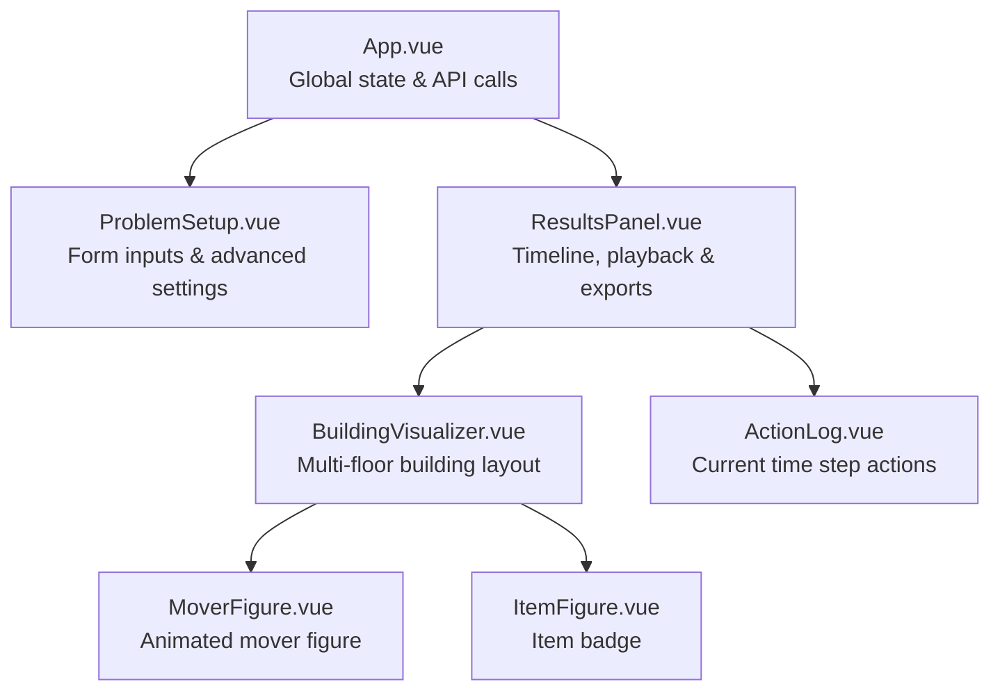

# OptiMove Frontend

The web interface of [OptiMove](../README.md): an interactive, responsive application built with **Vue 3**, **Vite 8**, and **Tailwind CSS v4** to configure, solve, and visually inspect solutions to the "Movers" SAT planning problem. It communicates with the FastAPI backend to generate optimal logistics plans using the **Glucose-3** SAT solver and renders them through an animated elevator-shaft building simulation.

---

## Table of Contents

- [Features](#features)
- [Component Architecture](#component-architecture)
- [System Flow & State Management](#system-flow--state-management)
- [Getting Started](#getting-started)
  - [Prerequisites](#prerequisites)
  - [Installation](#installation)
  - [Environment Configuration](#environment-configuration)
  - [Development Server](#development-server)
  - [Production Build & Preview](#production-build--preview)
  - [Linting and Code Formatting](#linting-and-code-formatting)
  - [Tests](#tests)
- [Docker Setup](#docker-setup)
- [Tech Stack](#tech-stack)

---

## Features

- **Interactive Problem Setup:**
  - Toggle between **Task 1** (movement only) and **Task 2** (movement and item carrying).
  - Dynamically configure the number of floors ($N$) and movers ($M$).
  - Customize mover display names (e.g. *Joe*, *Bill*, *Mia*).
  - Configure individual destination floors for Task 1.
  - Add, edit, and remove items with custom initial floor placements for Task 2.
- **Dual Solving Modes:**
  - **Optimal (Iterative Deepening):** Automatically determines the minimum time horizon $T^*$ needed to solve the instance.
  - **Fixed Horizon ($T$):** Checks satisfiability for an exact number of time steps (useful for infeasibility checks).
- **Animated Building Visualizer:**
  - Custom-built multi-floor elevator shaft showing movers and items positioned on their corresponding floors at each time step $t$.
  - Animated mover figures with state indicators and smooth visual cues.
- **Timeline & Playback Controls:**
  - Full playback controls: Play/Pause, Step Forward, Step Backward, and Reset to $t = 0$.
  - Variable playback speeds: `1x`, `2x`, and `4x`.
  - Interactive step slider for scrubbing directly through the execution timeline.
- **Live Action Log:**
  - Step-by-step breakdown of actions performed by each mover (`ascends`, `descends`, `idle`, or `carries <item>`).
- **Solver Statistics:**
  - Solve time, number of variables and clauses, and, for UNSAT results, the last horizon tested.
- **Logic & DIMACS Export:**
  - One-click downloads of the `DIMACS CNF` (`.cnf`) formula and the `Variable Mapping` (`.json`), for both SAT and UNSAT results, to verify them in other solvers.
- **Readable Errors:**
  - Invalid input rejected by the backend (HTTP 422) is shown as a field-by-field message.

---

## Component Architecture

The frontend follows a clean **Smart Parent / Focused Child** architecture:

```
frontend/src/
├── App.vue                         # Root Smart Component: state container, solver trigger
├── main.js                         # Application bootstrapper
├── api/
│   └── client.js                   # Shared request() helper + /solve, /solve/fixed, /cnf, /mapping
├── assets/
│   └── main.css                    # Global stylesheet & Tailwind CSS entry point
├── utils/
│   └── payload.js                  # Converts the form state into the API request body
└── components/
    ├── ProblemSetup.vue            # Reactive form: tasks, floors, movers, items, modes
    ├── ResultsPanel.vue            # Playback toolbar, solver metrics, export buttons
    ├── BuildingVisualizer.vue      # Elevator-shaft floor renderer
    ├── MoverFigure.vue             # Animated mover avatar with labels & indicators
    ├── ItemFigure.vue              # Item badge with icon & floor markers
    └── ActionLog.vue               # Textual activity log for the current time step
```

### Component Hierarchy & Responsibilities



- [`src/App.vue`](src/App.vue): Manages top-level reactive state (`form`, `isLoading`, `error`, `solveResponse`), handles form submission (the payload is built by [`src/utils/payload.js`](src/utils/payload.js)), and calls the solver endpoints.
- [`src/components/ProblemSetup.vue`](src/components/ProblemSetup.vue): Renders task selectors, mover count sync, custom mover names, dynamic item management, and a collapsible advanced drawer for solver modes and bounds.
- [`src/components/ResultsPanel.vue`](src/components/ResultsPanel.vue): Displays solver execution statistics (solve time, variables, clauses, SAT/UNSAT outcome), timeline playback timer (`setInterval`), speed toggles (`1x`, `2x`, `4x`), and triggers CNF/mapping file downloads.
- [`src/components/BuildingVisualizer.vue`](src/components/BuildingVisualizer.vue): Renders building floors in reverse order ($N-1$ down to $0$), placing movers and items in their respective floor compartments for the active step $t$.
- [`src/components/MoverFigure.vue`](src/components/MoverFigure.vue): Renders stylized SVG movers with bobbing animation and mover identification tags.
- [`src/components/ItemFigure.vue`](src/components/ItemFigure.vue): Renders identifiable item badges with starting and current positions.
- [`src/components/ActionLog.vue`](src/components/ActionLog.vue): Formats and displays the transition actions ($t \to t+1$) taking place in the current simulation slice.

---

## System Flow & State Management

1. **User Input:** The user adjusts parameters in `ProblemSetup.vue`.
2. **Payload Construction:** `buildPayload()` in `utils/payload.js` converts the form (Task 1 goal floors become `{index: floor}`, Task 2 sends the items, and either `max_steps` or `time_steps` is set by the mode).
3. **Solver Request:** `api/client.js` calls `POST /api/solve` (or `POST /api/solve/fixed`) using native `fetch` with an `AbortSignal.timeout(120000)` safeguard. The backend aborts after 118 s, so its `504` message normally arrives first.
4. **Plan Decoding:** Upon receiving a satisfiable response, `ResultsPanel.vue` initializes the timeline at $t = 0$.
5. **Interactive Visualization:** The user plays the simulation or scrubs manually. At each time step $t$, `BuildingVisualizer.vue` and `ActionLog.vue` receive the slice `plan[t]` to render positions and transitions.
6. **Artifact Downloads:** Clicking **DIMACS CNF** or **Mapping** queries `/api/cnf/{solve_id}` or `/api/mapping/{solve_id}` and triggers an in-browser blob download.

---

## Getting Started

### Prerequisites

- **Node.js:** `^20.19.0` or `>=22.12.0` (as defined in `package.json`)
- **npm:** `v10+`

### Installation

Navigate to the `frontend/` directory and install the exact versions from the lockfile:

```bash
cd frontend
npm ci
```

### Environment Configuration

The application connects to the backend API via the `VITE_API_BASE_URL` environment variable. By default, it falls back to `http://localhost:8000/api`.

To override it, copy the example file and edit it:

```bash
cp .env.example .env
```

```env
VITE_API_BASE_URL=http://localhost:8000/api
```

The production Docker image builds with `VITE_API_BASE_URL=/api` and lets nginx proxy the API on the same origin.

### Development Server

Start Vite with hot-module replacement (configured to port 3000):

```bash
npm run dev
```

Open your browser and navigate to:
**[http://localhost:3000](http://localhost:3000)**

### Production Build & Preview

Compile and optimize assets for production:

```bash
npm run build
```

The minified bundle will be generated in `frontend/dist/`. To preview the production build locally:

```bash
npm run preview
```

### Linting and Code Formatting

| Command                | What it does                                                   |
|------------------------|----------------------------------------------------------------|
| `npm run lint`         | Oxlint + ESLint, **auto-fixes** problems                       |
| `npm run format`       | Prettier (with the Tailwind CSS plugin), **rewrites** files    |
| `npm run check:lint`   | Same linters without modifying files (used in CI)              |
| `npm run check:format` | Prettier check without modifying files (used in CI)            |

### Tests

Unit tests use [Vitest](https://vitest.dev/) and live in `tests/`:

```bash
npm test
```

They cover the API client (error formatting, timeouts, responses) and the payload builder.

---

## Docker Setup

The [`Dockerfile`](Dockerfile) has three targets:

| Target  | Contents                                                                                         |
|---------|--------------------------------------------------------------------------------------------------|
| `dev`   | Vite dev server with hot reload on port 3000 (used by `docker-compose.yml`)                      |
| `build` | Runs `npm run build`                                                                             |
| `prod`  | nginx serving `dist/` on port 80, proxying `/api` to `backend:8000` ([`nginx.conf`](nginx.conf)) |

```bash
docker build --target dev -t optimove-frontend:dev .
docker run -p 3000:3000 optimove-frontend:dev
```

The `prod` target expects a `backend` host, so run it together with the backend from the repository root:
`docker compose -f docker-compose.prod.yml up --build` (or `docker compose up --build` for development).

---

## Tech Stack

- **Framework:** Vue 3 (Composition API, `<script setup>`)
- **Styling:** Tailwind CSS v4 (`@tailwindcss/vite`)
- **Build Tool:** Vite 8
- **Linting & Formatting:** ESLint, Oxlint, Prettier, `prettier-plugin-tailwindcss`
- **Testing:** Vitest
- **Production server:** nginx (Docker `prod` target)
- **Architecture:** Zero heavy 3D/Canvas runtime dependencies — native DOM and responsive SVG elements.
